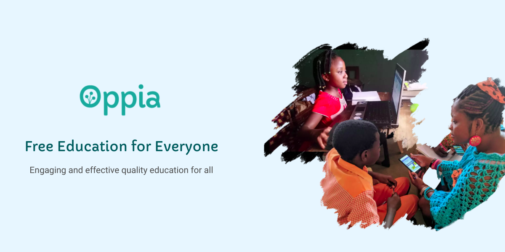

Oppia is an open-source project whose aim is to empower learners across the globe by providing access to high-quality, engaging education. We envision a society in which access to high-quality education is a human right rather than a privilege.

 
	
<b>"I want more info❗"</b>

    <ul>
        <li><a href="https://www.oppia.org/about">About our platform</a></li>
    </ul>

## :computer: [Oppia (Web)](https://github.com/oppia/oppia) | [][GitHub_Discussion_Web]

The web version of Oppia currently provides a growing curated set of lessons on Basic Mathematics, together with tools for creating them and augmenting them with translations and voiceovers to support learners who don’t speak English and learners who are less proficient at reading. Visit [Oppia.org](https://www.oppia.org/learn/math) to access these lessons.

Oppia Web is written using Python, Typescript, and Angular.

 - [How do I get started?](https://github.com/oppia/oppia/wiki)  
 - [Codebase Overview](https://github.com/oppia/oppia/wiki/Overview-of-the-Oppia-codebase)

[GitHub_Discussion_Web]: https://github.com/oppia/oppia/discussions

## 📱 [Oppia Android](https://github.com/oppia/oppia-android) | [][GitHub_Discussion_Android]

The Oppia Android app is now available in beta! It provides access to Oppia's curated numeracy lessons and allows users to download lessons and play them offline, making quality education available even with limited internet connectivity. The app is designed to be easily shared across multiple members of the same household. Download the app from the Google Play Store: [Oppia - Apps on Google Play](https://play.google.com/store/apps/details?id=org.oppia.android&hl=en_US)

Oppia Android is written using Kotlin and Java, and it leverages Bazel, databinding, Dagger 2, and AndroidX.

 - [How do I get started?](https://github.com/oppia/oppia-android/wiki)  
 - [Codebase Overview](https://github.com/oppia/oppia-android/wiki/Overview-of-the-Oppia-Android-codebase-and-architecture)

[GitHub_Discussion_Android]: https://github.com/oppia/oppia-android/discussions

## :robot: [Oppiabot](https://github.com/oppia/oppiabot)

Oppiabot is a GitHub app built with probot and Github Actions. It acts as a helper for Oppia’s code repositories to maintain the development workflow. It is hosted on Heroku.

Oppiabot is written using JavaScript.

## Connect with us!

[][twitter] [][LinkedIn] [][Facebook] [][medium] [][oppia-org-youtube] [][dev-youtube]

[twitter]: https://twitter.com/oppiaorg
[linkedIn]: https://www.linkedin.com/company/oppia-org/
[medium]: https://medium.com/oppia-org
[facebook]: https://www.facebook.com/oppiaorg/
[oppia-org-youtube]: https://www.youtube.com/channel/UC5c1G7BNDCfv1rczcBp9FPw
[dev-youtube]: https://www.youtube.com/channel/UCsrAX-oeqm0-NIQzQrdiUkQ

